# SlientClip

Auto-clip the most viral moments from Twitch live streams into vertical **YouTube Shorts / TikTok / Instagram Reels**, with captions, title, description, viral point and hashtags, then post them on a schedule.

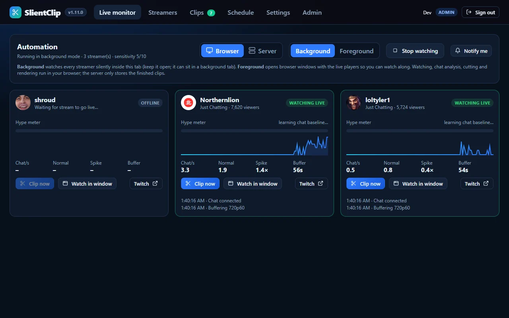

Each user chooses **where watching and clipping run**:

- **Browser** (default): watching, chat analysis, cutting and 9:16 rendering run in the user's browser (Web Workers + ffmpeg.wasm). The server only stores the results.
- **Server**: the same pipeline runs inside the server (native ffmpeg + Whisper on Node), so clipping continues after the user closes the web app or turns off their computer.

Finished clips are posted to YouTube / TikTok / Instagram **without API keys**, by driving a real logged-in browser like a person would. YouTube can go out **either way**: through the server's own browser, which is **kept open and active around the clock** per user so the login never idles out, or through **your own Chrome with the SlientClip extension**, so no YouTube login lives on the server at all.

## Screenshots

| | |
|---|---|
| 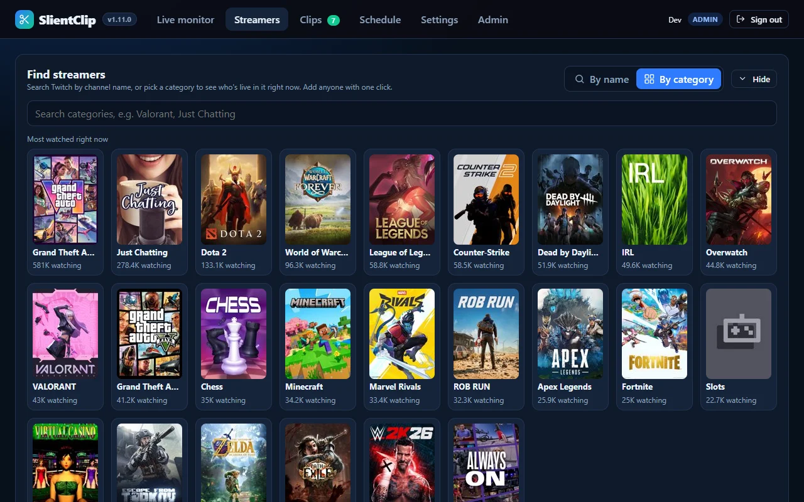 **Find streamers** by name or category, see who's live, add with one click | 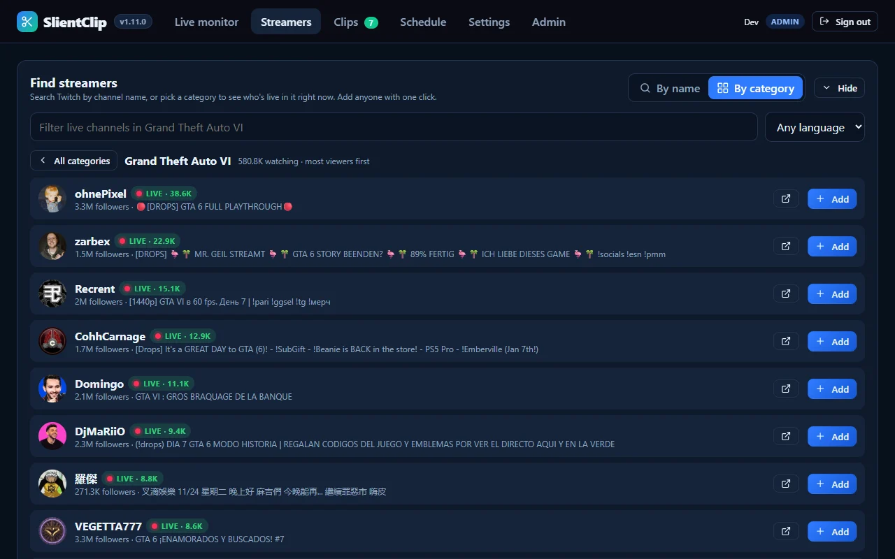 **Live in a category**, most viewers first, filter by language |
| 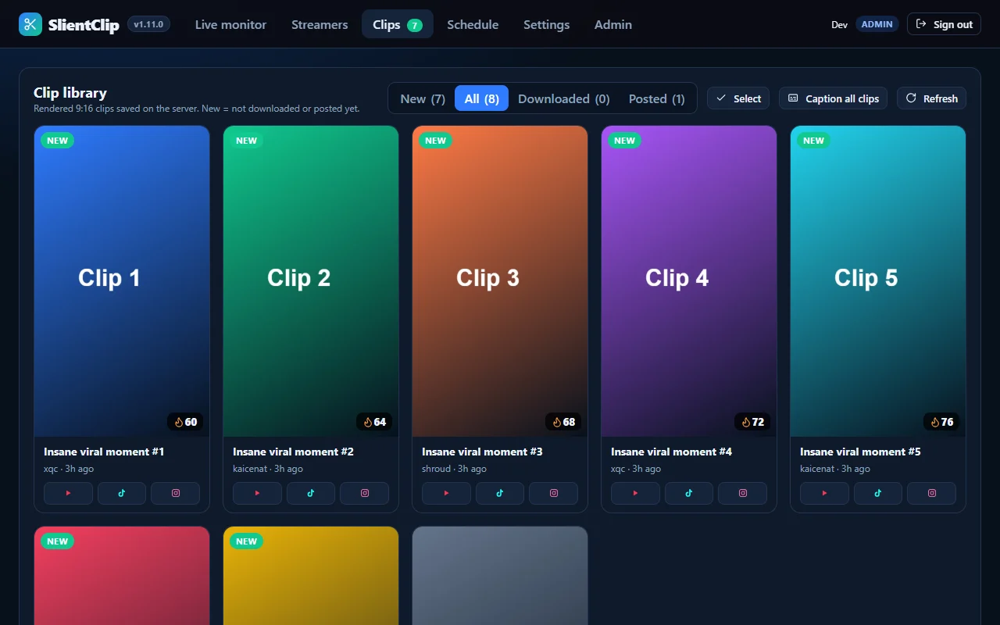 **Clip library** with one-click posting per platform | 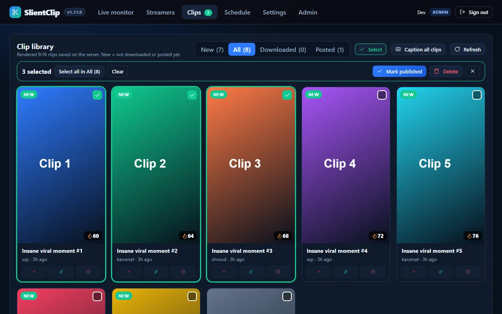 **Select** clips to delete or mark published |
| 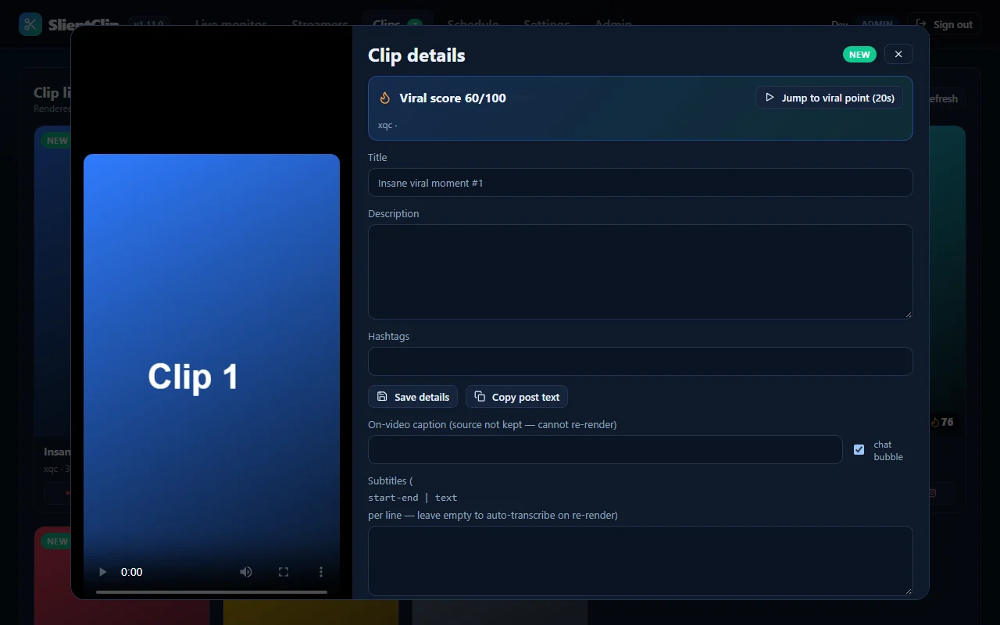 **Clip details**: viral score, title, description, hashtags, captions | 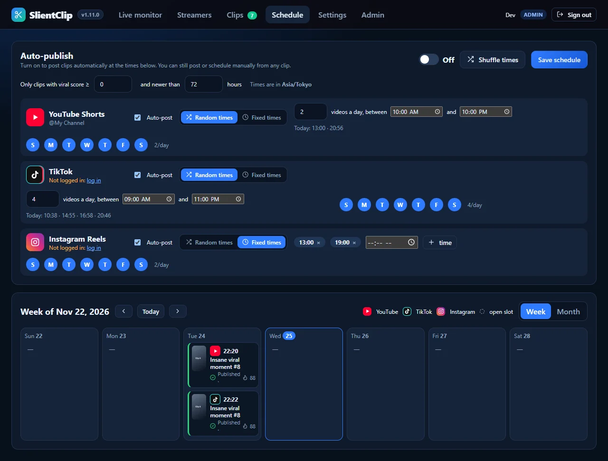 **Auto-publish** with random or fixed times, and the calendar |
| 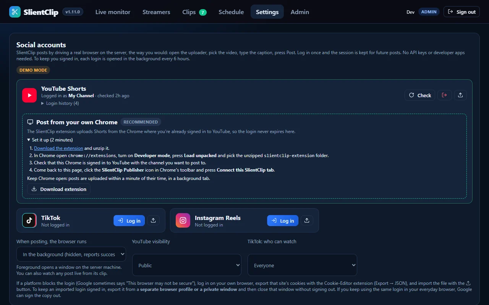 **Social accounts**, login history and the Chrome extension | 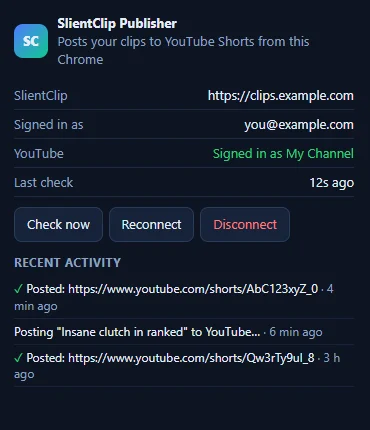 **SlientClip Publisher** extension popup |
| 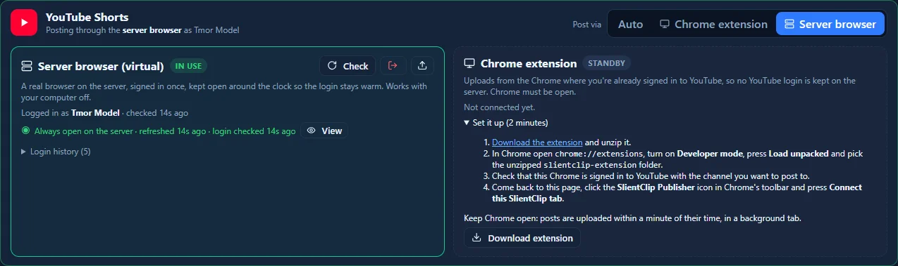 **YouTube, two ways**: server browser kept open, or the Chrome extension | |
| 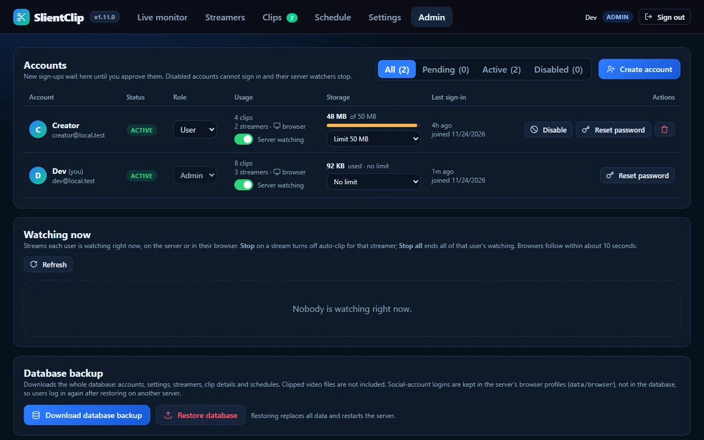 **Admin**: approvals, storage limits, server watching, who's watching now, database backup | 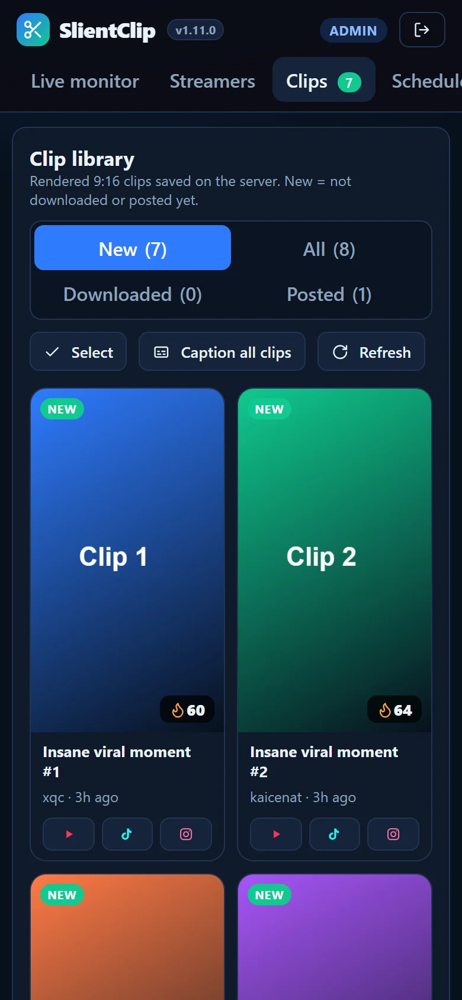 **Phone** layout |

## Features

**Finding and watching streams**
- Add Twitch streamers by link (`https://www.twitch.tv/name`), or **Find streamers** on the Streamers tab: search channels **by name**, or pick a **category** to see who's live in it right now (most viewers first, optional language filter) and **Add** with one click. The finder can be collapsed and remembers it.
- **Multi-stream watching**: one worker per streamer, any number at once. Watching starts automatically when a streamer goes live.
- **Background mode** (silent, inside the app tab, which may sit in a background tab) or **Foreground mode** (one browser window per streamer, or one grid window, with live players).
- **Run on server** option: watch and clip on the server, so clipping continues when the web app is closed.
- Watching only shows as running when it really is, and never starts by itself unless you turn on auto-start.

**Clipping**
- Chat analysis (Twitch IRC over WebSocket) detects spikes in message rate, emotes, hype words and copy-paste spam against a rolling baseline.
- On a viral moment the app cuts **20 s before + 10 s after** (configurable) from an in-memory HLS ring buffer, renders **9:16** (blurred background or center crop) and saves it.
- **Every clip is captioned by default**: a hook headline, the top chat reaction bubble, and **spoken-word subtitles** transcribed with Whisper in the streamer's broadcast language.
- Auto-generated **title, description, viral point (score, reason, chat evidence) and hashtags**.

**Clip library**
- **New / All / Downloaded / Posted** tabs, editable metadata and subtitles with caption re-render, **Caption all clips**, download.
- **YouTube / TikTok / Instagram buttons on every card**: one click posts the clip now, and the button shows whether it's posting, scheduled or posted.
- **Select** mode: tick clips or **Select all** in a tab, then **Delete** them or **Mark published**. Published clips are never auto-posted or scheduled again and are deleted automatically 24 hours later.
- Lazy loading with skeleton placeholders.

**Posting and scheduling**
- **Social accounts without API keys**: log in once through a live view of the server's browser; posts run in the background with a success/failure report, or in the foreground where you can watch.
- **YouTube, two ways**: the **server browser (virtual)**, kept open and active per user around the clock so the session never suspends or times out, or the **SlientClip Publisher** extension, which uploads from the Chrome you're signed in to. **Post via** picks one (Auto / Chrome extension / Server browser).
- **Auto-publish** per platform: **Random times** (N videos a day inside a time window, natural-looking times that change daily, **Shuffle times**) or **Fixed times**, plus posting days and a minimum viral score. The planner fills upcoming slots with your best unposted clips.
- **Schedule calendar** (week / month): scheduled, published and failed posts, open slots, drag-and-drop rescheduling, post now / retry / unschedule. Posts of deleted clips stay as **history**.
- Logins are kept alive in the background, YouTube signs itself back in when it can, and each account has a **login history** showing why a login was kept or lost.

**Accounts and admin**
- Email/password accounts and **Google sign-in**; **new accounts need admin approval**.
- **Admin console**: approve, disable, create, reset passwords, change roles, delete; **access expiry dates**; per-user usage, **storage limits** (oldest clips are replaced when full), a **server-watching switch**, **Watching now** with **Stop**, and **whole-database backup / restore**.
- **Settings backup**: every user can download and restore their settings, schedule and streamer list.
- Sign-ins don't expire while in use (sliding 400 days).

**Deployment**
- A **product landing page** at `/`: hero, how it works, features with screenshots, use cases, pricing (monthly / yearly), FAQ and sign-up buttons. The app lives at `/app`: signed-out visitors are always sent to the landing page, signed-in users opening `/` go straight to the app, and signing out or an ended session returns to the landing page. Copy and prices live in `public/landing.html`.
- `docker compose` with Chromium and ffmpeg included; you deploy updates with `git pull` + `docker compose up -d --build`.
- **Welcome tour** for new accounts on their first sign-in: it walks through finding streamers, starting to watch, clips, auto-publish, social accounts (and Admin for admins), switching tabs and spotlighting each part. Back / Next / Skip, arrow keys and Esc work. The **?** button in the top bar replays it any time. Accounts that existed before the tour aren't shown it automatically.
- Responsive UI: phones get scrolling tabs, two clips per row, a full-screen editor, a one-column calendar and card-style admin tables.

## Architecture

```
Browser (per user)                                        Server (Node + SQLite)
┌───────────────────────────────────────────────┐         ┌───────────────────────────────┐
│ watcher.worker.js  (one per streamer)         │         │ auth (email + Google)         │
│  ├─ live check   → gql.twitch.tv (CORS)       │  ───►   │ streamers / settings / admin  │
│  ├─ HLS buffer   → Twitch CDN segments (CORS) │         │ clips: mp4 / jpg / source     │
│  ├─ chat         → irc-ws.chat.twitch.tv      │         │ master-playlist relay*        │
│  └─ analyzer     → viral moment               │         │ server watchers (ffmpeg,      │
│ render.js (ffmpeg.wasm) → 9:16 mp4 + captions │─upload─►│   Whisper) for "Run on server"│
└───────────────────────────────────────────────┘         │ publisher: queue + planner    │
                                                          │  ├─ Chromium profile per user │──► YouTube Studio /
                                                          │  │  + platform (server posts) │    TikTok Studio / Instagram
                                                          │  └─ /api/ext for the extension│
                                                          └───────────────┬───────────────┘
Your Chrome + SlientClip Publisher extension                              │ due YouTube posts,
┌───────────────────────────────────────────────┐                         │ video, results
│ background.js: polls every 30 s, claims a post│◄────────────────────────┘
│ youtube-upload.js: uploads in a Studio tab    │──► YouTube Studio (your signed-in account)
└───────────────────────────────────────────────┘
```

\* Twitch's `usher` endpoint (the master `.m3u8`, a tiny text file) only sends CORS headers to twitch.tv, so the server relays just that one text manifest. Media playlists and all video segments are fetched by the browser directly.
## Quick start (Docker Compose)

```bash
git clone https://<user>:<token>@github.com/<owner>/<repo>.git slientclip
cd slientclip
cp .env.example .env      # fill in values (see below)
docker network create tunnel_net   # once; skip if it already exists
docker compose up -d --build
# open http://<host>:8080
```

The app joins the external Docker network `tunnel_net` (rename with `TUNNEL_NETWORK` in `.env`), so a tunnel or reverse-proxy container on that network (cloudflared, Caddy, Nginx, Traefik…) can reach it at `http://app:8080` without publishing a port. It also keeps its own default network and the `APP_PORT` mapping.

Put it behind HTTPS (Caddy, Nginx, Traefik, Cloudflare Tunnel…) for production and set `PUBLIC_URL=https://…` so cookies are marked `Secure`.

### Google sign-in (client ID + callback)

1. Google Cloud Console → APIs & Services → Credentials → **Create OAuth client ID** → *Web application*
2. **Authorized JavaScript origins**: `https://clips.example.com`
3. **Authorized redirect URIs**: `https://clips.example.com/auth/google/callback`
4. Set in `.env`:
   ```
   GOOGLE_CLIENT_ID=xxxx.apps.googleusercontent.com
   GOOGLE_CLIENT_SECRET=xxxx
   GOOGLE_CALLBACK_URL=https://clips.example.com/auth/google/callback
   ```

### Social accounts (posting to YouTube / TikTok / Instagram)

There are **no developer apps, API keys or OAuth redirects** to set up. Posting works the way a person does it, in a real browser that runs on the server:

1. **Settings → Social accounts → Log in.** The server opens the platform's login page in its own Chrome/Chromium and streams it into the app. Click and type in that live view to sign in normally, including 2-step verification, then press **I'm logged in**. The session is saved in a browser profile per user and platform (`data/browser/<user>/<platform>`) and reused for every future post.
2. **Post now / Schedule / Auto-publish.** For each post the server opens the platform's uploader (YouTube Studio, TikTok Studio, Instagram *Create*), picks the clip, types the title, caption and hashtags word by word with human-like pauses, sets visibility, and presses Post.
3. **Results.** Each post shows its live step ("Uploading video", "Writing caption"…). Press **Watch** to see the browser at work. When it finishes you get a success or failure notification, including posts that finished while the app was closed. Failures keep a **screenshot** of what the browser showed.

Settings per user: **background** (hidden browser, reports the result) or **foreground** (also opens a visible browser window, when the server machine has a screen), YouTube visibility (public / unlisted / private), and TikTok "who can watch" (everyone / friends / only me). If a private option can't be set, the post is stopped rather than published publicly.

Safety rules:
- Before every post the saved session is checked. If the platform logged it out, the post fails with "log in again" and the account is flagged in Settings.
- **YouTube stays open on the server.** Once signed in (and while YouTube posts go through the server browser), each user's YouTube browser is **kept open permanently**, not only opened for posts. It keeps Studio loaded, reloads it every 10 minutes (`SOCIAL_KEEP_OPEN_REFRESH_MIN`) and re-checks the login every 3 hours (`SOCIAL_KEEP_OPEN_CHECK_HOURS`). The page always counts as focused and visible, and Chromium's background throttling is off, so the tab is never suspended or frozen. Posts, **Check** and re-logins briefly take the profile over (a running step is finished first) and the session reopens right after. If it closes or crashes it's reopened automatically, backing off up to 30 minutes on repeated failures. Settings shows *Always open on the server* with **View** to watch or use that browser live, for example to answer a Google "confirm it's you" prompt. Each open browser takes roughly 150–300 MB RAM; `SOCIAL_KEEP_OPEN_MAX` (default 20) caps them and `SOCIAL_KEEP_OPEN=false` turns it off.
- **Logins are kept alive.** Every 6 hours (`SOCIAL_KEEPALIVE_HOURS`, `0` turns it off) each saved login is opened in the background, visits the platform for ~20 s (`SOCIAL_KEEPALIVE_DWELL_SEC`) so the site refreshes its login cookies, and is checked to confirm it's still signed in. **Check** really asks the platform (for YouTube, YouTube's own signed-in flag) instead of only looking at cookies. A login is only marked expired on a clear answer, and Settings shows why.
- **YouTube signs itself back in.** If YouTube says it's signed out (on keep-alive, Check or while posting) but the Google account in that browser is still signed in, SlientClip runs Google's silent sign-in and carries on, with no new login needed. Each account has a **Login history** in Settings (last 20 events: signed in, kept alive, re-signed in, posted, expired and why).
- **Clean shutdown keeps cookies.** On `docker compose` stop/redeploy (SIGTERM) the app closes its browsers and waits for Chromium to exit before quitting, so the login cookies Google just rotated are saved. Re-using stale rotated cookies is a common reason Google signs a session out. The compose file gives it `init: true` and a 30 s grace period.
- **Profiles survive redeploys.** A Chromium killed mid-session leaves a profile lock stamped with the old container's hostname, and a new container then refuses the profile ("in use by another computer"), which broke login, Check and posting after a redeploy. Locks whose Chromium is gone are now cleared automatically; a Chromium still closing is waited for.
- **Same device every time.** The hidden browser presents exactly the identity of the visible one (the browser's real user agent and client hints, only without "Headless"), so a login made in a visible window isn't treated by Google as a session copied to another device.
- Your SlientClip sign-in doesn't expire while you use it: every visit extends it to 400 days.
- A failure **before** pressing Post is retried automatically (up to 3 times). A failure **after** pressing Post is never retried, because the video may already be live. The same applies to posts interrupted by a server restart.
- Only one browser runs per account at a time; `MAX_PUBLISH_BROWSERS` (default 2) limits browsers server-wide.

If a platform refuses the login in an automated browser (Google sometimes shows "This browser or app may not be secure"), log in on your own browser, export that site's cookies with the *Cookie-Editor* extension (**Export → JSON**), and use the upload button next to the account to import them. Export from a separate browser profile or a private window and close it without signing out: if the same Google login keeps being used in your everyday browser, Google rotates its cookies there and signs the imported copy out.

**YouTube: From my Chrome.** With the SlientClip Publisher extension (v1.1+) connected, the **From my Chrome** button on the YouTube server-browser box does that export for you: it downloads this Chrome's YouTube/Google login as `youtube-cookies-<date>.json` (Cookie-Editor format, HttpOnly cookies included), then offers to sign the server browser in with it right away. The extension only answers your own paired SlientClip site, asks you to allow every copy in its own dialog, and returns only `youtube.com` / `google.com` cookies. Without the extension (or with an older one) the button explains how to install or update it and reconnect.

### YouTube: server browser or your own Chrome

YouTube has both options side by side in **Settings → Social accounts**, and **Post via** chooses which one posts:

- **Auto** (default): the Chrome extension when it's connected and signed in to YouTube, otherwise the server browser.
- **Chrome extension**: always hand YouTube posts to your Chrome. The server browser isn't kept open in this mode.
- **Server browser**: always post from the server's always-open browser, even when the extension is connected.


### YouTube from your own Chrome (SlientClip extension)

If YouTube logins on the server keep expiring, let your own Chrome do the uploading instead. The **SlientClip Publisher** extension (`extension/` in this repo, or **Settings → Social accounts → YouTube → Download extension**) uploads Shorts from the Chrome where you're already signed in to YouTube, so no YouTube login is kept on the server at all.

1. Download the extension zip and unzip it. In Chrome open `chrome://extensions`, turn on **Developer mode**, press **Load unpacked** and pick the `slientclip-extension` folder.
2. Make sure that Chrome is signed in to YouTube with the channel you want to post to.
3. Open SlientClip in that Chrome, click the **SlientClip Publisher** toolbar icon and press **Connect this SlientClip tab**. With **Post via: Auto**, YouTube posts now go through your Chrome. A server-browser login, if you have one, stays saved as the fallback.


From then on, **Post now**, scheduled posts and auto-publish for YouTube are handed to the extension. Every 30 seconds it checks for due posts, opens YouTube Studio in a background tab, uploads the clip, types the title, description and hashtags, sets the audience and your visibility setting, presses Publish and reports the link back. The post shows each step live, like server posts. Keep Chrome open for scheduled posts; anything due while Chrome was closed goes out within a minute of opening it.

- Same safety rules as the server browser: failures before Publish are retried (up to 3 times), failures after pressing Publish are not, and an upload that stops reporting for 15 minutes (`EXT_STALE_MIN`) is marked failed.
- If YouTube is signed out in that Chrome, the post fails with "sign in on youtube.com" and Settings flags the account. Signing in again and pressing **Check now** in the popup reconnects it.
- The popup shows the connection, the YouTube account it found and recent activity. **Disconnect** (popup or Settings) revokes its token. The extension talks to SlientClip with that token only, and to YouTube only through its own tabs.
- `PUBLISH_DRY_RUN=true` makes the extension stop before Publish, which leaves a draft in YouTube Studio.

Notes: the Docker image includes Chromium. `npm run dev` finds an installed Chrome or Edge, or you can set `BROWSER_PATH`. Platforms change their pages from time to time; when that breaks a step, the failure screenshot shows where. Automated posting may be against a platform's terms, so use your own accounts responsibly.

Set `PUBLISH_DRY_RUN=true` to try posting, scheduling and auto-publish safely: logins still open the real browser, but posts are simulated and marked *Demo mode*.

### Updating the server

There is no auto-updater: a push to GitHub doesn't change the server until you deploy it. On the server:

```bash
cd slientclip
git pull
GIT_COMMIT=$(git rev-parse HEAD) docker compose up -d --build --remove-orphans
```

Clips, logins and the database live in the `data` volume and survive updates. `--remove-orphans` also removes the `updater` container left over from older versions, which had an auto-updater.

### Which version is deployed?

The running release is shown as a badge next to the logo (hover it for the commit, build time and server start time), on the sign-in page, and under **Admin → Deployed version**. `GET /healthz` returns the same data as JSON, e.g. `{"version":"1.5.0","commit":"9a36007","builtAt":"…","assets":"92d1cb245c00"}`.

- The version number comes from `package.json` — bump it for each release (`npm version minor --no-git-tag-version`).
- The commit and build time are stamped into the image when you pass `GIT_COMMIT` as above. Local `npm run dev` reads the commit from git.

### Every user gets the new release

Users never need a hard refresh or a cache clear after a deploy:

- **Versioned code URLs.** Pages are never cached and load their scripts and styles from `/v/<fingerprint>/…`, where the fingerprint (`assets` in `/healthz`) is a hash of the app's code. A release changes every code URL, including modules each script imports and its workers, so no browser, proxy or CDN (e.g. a Cloudflare tunnel's browser-cache TTL) can keep serving old code under a new version number. Within a release those files are cached as immutable, so pages still load fast.
- **Open tabs update themselves.** Each page checks the server every minute and whenever it's shown again. When the server runs newer code, the page reloads itself onto it right away (keeping the current tab). It waits while you're in the middle of something: typing, an open dialog, or watching and rendering clips in this browser. Meanwhile a **New version · Update** button is shown, and the page updates as soon as you're done (or when you click it). Watch windows that watch in the browser update only when you click the button.
- API responses are sent with `no-store`, so data is always live too.

## Using it

1. Open the site: visitors see the product page, and **Start free** / **Sign in** lead to the account form; after signing in you're taken to the app at `/app`. Sign in (the first account is the administrator; later sign-ups wait in **Admin → Accounts** until approved) → **Streamers** → paste Twitch links, or use **Find streamers**: search channels **by name**, or pick a **category** (most watched first, or search one) to see who's live in it now, sorted by viewers and optionally filtered by language, then **Add** with one click. **Hide** folds the finder away (remembered on that device).
2. **Live monitor** → choose **Browser** or **Server**, then (browser) **Background** or **Foreground** → **Start watching**.
   - **Server** keeps watching and clipping after you close the page; come back any time to see progress and clips. The choice survives server restarts and updates.
   - Foreground opens a window per streamer (or one grid window). If the browser blocks pop-ups, allow them for the site or use **Watch in window** per streamer.
   - Each streamer is watched by exactly one window/tab at a time (Web Locks), so modes can be mixed safely.
3. When chat explodes, the card shows *Capturing → Rendering 9:16 → Saved*. **Clip now** captures manually.
4. **Clips** → each card has **YouTube / TikTok / Instagram** buttons: one click (and a confirm) posts the clip right away. If that account isn't logged in yet, the login opens first, and the button shows whether the clip is posting, scheduled or already posted. Open a clip to tweak title/description/hashtags/caption (re-render), or to **Schedule** a post (or *post manually* if the account isn't linked). Downloaded/posted clips leave the *New* list.
   - **Select** (Clips toolbar) turns on checkboxes: tick clips or **Select all** in the current tab (New / All / Downloaded / Posted), then **Delete** them or **Mark published**. Published clips (ones you posted yourself) move to *Posted*, are never auto-posted or scheduled again, and are deleted automatically 24 hours later (`PUBLISHED_TTL_HOURS`). **Unmark** keeps a clip.
   - Deleting a clip (by hand, by the 24 h clean-up or by the storage limit) keeps its **Schedule history**: published and failed posts stay in the calendar with the clip's title, streamer, score and thumbnail, tagged *deleted*. Posts that were still waiting to go out are dropped.
5. **Schedule** → turn on **Auto-publish**. Per platform, choose **Random times** (e.g. *4 videos a day between 09:00 and 23:00*; the times are picked for you, spread over the window and different each day) or **Fixed times**, then the days and a minimum viral score. The calendar shows what goes out when; drag a post to another day, or click it to post now, reschedule, retry or unschedule.

### Accounts & administration

- The first account ever created (or the account with `ADMIN_EMAIL`) is an active administrator. Everyone else who signs up (email or Google) is **pending** until an admin approves them; set `REQUIRE_APPROVAL=false` to skip approval.
- **Admin → Accounts**: approve, disable / enable (signs the user out and stops their server watchers), create accounts (blank password = generated temporary password shown once), reset passwords, promote / demote admins, delete accounts with all their clips. The last active admin cannot be removed or demoted.
- **Storage limits**: the **Storage** column shows each account's clip storage (videos, thumbnails and kept sources) and lets an admin set a limit (presets or a custom size in GB; *No limit* is the default). When a clip is saved and the account is over its limit, its **oldest clips are deleted to make room**, like a recording loop. The clip just saved and clips with a scheduled or in-progress post are never removed. Users see a usage bar in their clip library, and a notice when older clips were replaced.
- **Watching now** lists every user who is watching right now, on the server or in their browser (open dashboards report what they watch every 10 s), with each stream's live status. **Stop** on a stream turns off auto-clip for that streamer; **Stop all** switches off the user's server watching and tells their open browser to stop. Browsers follow within about 10 seconds, and the user sees a notice.
- **Access expiry** (under each account's status): give an account access until a date (7 / 30 / 90 days, 1 year, or any date) and remove or change it any time. A week before the date the user sees a reminder. After it, they can still sign in and look around, but the app is grayed out and locked, with a banner asking them to contact the administrator (`ADMIN_EMAIL` or the first admin, with a mail link). Watching (browser and server), clipping, posting, scheduling, downloads and changes stop, and the server refuses them too; due posts wait until access is renewed. **Check again** (or the next 10-second check) unlocks the app as soon as an admin renews it. Administrators never expire.
- **Server watching** (switch under each account's usage): allowed by default. Turning it off immediately stops that account's server watchers, moves them back to watching in their browser, and blocks choosing **Server** again (the option is greyed out with an explanation; an open page switches back on its own). Turn it back on to let them pick **Server** again.
- **Admin → Database backup** downloads a consistent SQLite copy (`VACUUM INTO`) of everything except the video files. **Restore** validates the file, swaps it in and restarts the server (Docker restarts the container). Social-account logins live in the browser profiles under `data/browser/`, not in the database, so after restoring on another server users log in again.
- **Settings → Backup & restore settings** (every user): JSON file with clipping settings, auto-publish schedule and streamers; restore merges or replaces the streamer list. Clips and linked-account tokens are not included.

### Settings

Sensitivity (1–10), seconds before/after the viral point, chat reaction delay, cooldown, max clips/hour, layout (blur / crop), output resolution (540p / 720p / 1080p), hook + chat captions (on by default), auto subtitles (on by default) and subtitle language (auto = streamer's Twitch language), keep raw source (for re-rendering), run on browser or server, default mode, auto-start (off by default).

Watching only shows as running when it really is. Watching in the browser stops when its page is closed or reloaded, and the app comes back **Stopped** instead of restarting on its own. After a reload in foreground mode it only shows running once an open watch window reports in, and it stops by itself when all watch windows are closed. Server watching is reported by the server, so it keeps running after you close the page.

The speech model (~100 MB, `onnx-community/whisper-base_timestamped`) is downloaded from Hugging Face the first time a browser captions a clip and cached afterwards. Subtitles can be corrected per clip (`start-end | text` lines) and re-rendered.

## Configuration

Set these in `.env` (Docker Compose passes the common ones through; see `.env.example`).

| Variable | Default | What it does |
|---|---|---|
| `PUBLIC_URL` | – | Public address, e.g. `https://clips.example.com`; `https://` makes sign-in cookies `Secure` |
| `APP_PORT` / `PORT` | `8080` | Port published by Docker / port the app listens on |
| `TUNNEL_NETWORK` | `tunnel_net` | External Docker network the app joins, for a tunnel / reverse proxy (must exist) |
| `ALLOW_REGISTRATION` | `true` | `false` turns off sign-up |
| `REQUIRE_APPROVAL` | `true` | `false` activates new accounts without admin approval |
| `ADMIN_EMAIL` | – | This account is always an active administrator |
| `GOOGLE_CLIENT_ID` / `GOOGLE_CLIENT_SECRET` / `GOOGLE_CALLBACK_URL` | – | Google sign-in (see above) |
| `TWITCH_AUTH_TOKEN` | – | Turbo/subscriber OAuth token, so ad breaks don't replace the stream |
| `MAX_SERVER_STREAMERS` / `MAX_SERVER_WATCHERS` | `10` / `50` | Server watching limits per user / in total |
| `MAX_UPLOAD_MB` | `300` | Largest clip upload |
| `PUBLISH_DRY_RUN` | `false` | `true` simulates posts (*Demo mode*); the extension stops before Publish |
| `MAX_PUBLISH_BROWSERS` | `2` | Server browsers posting at the same time |
| `BROWSER_PATH` | auto | Chrome / Edge / Chromium used for logins and posting (Docker: Chromium) |
| `SOCIAL_KEEPALIVE_HOURS` / `SOCIAL_KEEPALIVE_DWELL_SEC` | `6` / `20` | How often saved logins are refreshed (`0` = off) and for how long |
| `SOCIAL_KEEP_OPEN` / `SOCIAL_KEEP_OPEN_MAX` | `true` / `20` | Keep each user's YouTube server browser open around the clock / at most this many at once |
| `SOCIAL_KEEP_OPEN_REFRESH_MIN` / `SOCIAL_KEEP_OPEN_CHECK_HOURS` | `10` / `3` | How often the always-open page is reloaded / its login re-checked |
| `SOCIAL_KEEP_OPEN_PLATFORMS` | `youtube` | Platforms kept open (comma-separated, e.g. `youtube,tiktok`) |
| `EXT_STALE_MIN` | `15` | An extension upload that stops reporting this long is marked failed |
| `PUBLISHED_TTL_HOURS` | `24` | Clips marked published are deleted after this long |
| `DATA_DIR` | `./data` (`/data` in Docker) | Database, clips, browser profiles |
| `FFMPEG_PATH` / `FONT_FILE` | `ffmpeg` / DejaVu Sans Bold | Server-side rendering |

## Notes & limitations

- In **Browser** mode keep at least one app tab/window open while watching. In **Server** mode nothing needs to stay open; the server needs CPU for rendering (about 15-30 s per clip with native ffmpeg, plus transcription) and clips are processed one at a time. Limits: `MAX_SERVER_STREAMERS` per user (default 10) and `MAX_SERVER_WATCHERS` in total (default 50).
- Browser mode: Chrome/Edge (desktop) recommended. A 30 s 720p clip takes roughly 1.5–2 minutes (transcription + render) on a typical laptop.
- During Twitch **ad breaks** anonymous viewers receive ads instead of the stream; those seconds can't be clipped. Setting `TWITCH_AUTH_TOKEN` to a Turbo/subscriber account's token avoids this.
- Posting drives each platform's own web uploader (YouTube Studio, TikTok Studio, Instagram), so no developer app or API quota is involved. When a platform changes its page, a step can break; the failure screenshot (server posts) or the failed Studio tab left open (extension posts) shows where. Failed uploads are retried up to 3 times and shown in red on the calendar.
- Auto-publish plans 7 days ahead; slots beyond that fill in as new clips arrive. A clip is never auto-posted twice to the same platform, and unscheduling a planned post keeps that clip off that platform's plan.
- Respect streamers' rights and each platform's terms when re-posting content.

## Development

```bash
npm install
npm run dev        # http://localhost:8080 — loads .env if present, restarts when server/ or public/js/engine/ change
npm test           # engine, API, publisher, real-browser posting and Chrome-extension tests
```

Requires Node ≥ 22.13 (uses the built-in `node:sqlite`). `DATA_DIR` defaults to `./data`; set it to point the dev server at another data folder. Front-end files are served uncached, so a browser reload picks up CSS/JS edits without a restart. Server-side watching needs `ffmpeg` on the PATH (the Docker image includes it).

The browser-posting test drives an installed Chrome, Edge or Chromium against a fake platform site. The extension test loads `extension/` into a Chromium build (branded Chrome ignores `--load-extension`): it uses Playwright's Chromium if installed (`npx playwright install chromium`) or `CHROMIUM_PATH`, and is skipped otherwise.

Project layout:

```
server/            Express API, SQLite (node:sqlite), publisher + planner, admin, backups
server/social/     server-browser posting: profiles, live viewer, YouTube / TikTok / Instagram drivers
server/watch/      server-side watching and rendering ("Run on server")
server/extension.js  API for the Chrome extension (/api/ext) and /extension.zip
public/            the web app (no build step); public/js/engine/ = watcher, analyzer, HLS, render, transcribe
extension/         SlientClip Publisher Chrome extension (Manifest V3)
test/              node:test suites
public/img/        landing-page and README screenshots
```

The UI is responsive: on phones the tabs scroll sideways, clips show two per row, the clip editor opens full screen, the calendar collapses to one column, and the admin table turns into cards.
